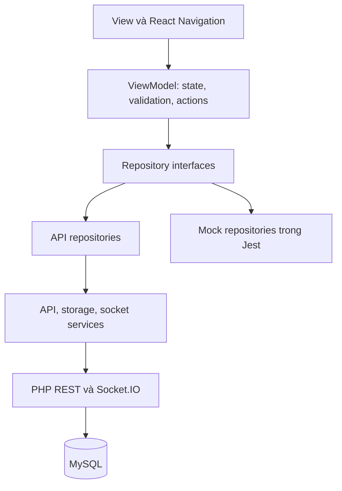

# Hướng dẫn bản hoàn thiện cuối kỳ

## 1. Phạm vi và trạng thái nghiệm thu

Lựa chọn: **Phần A + Phần B3 (MVVM)**, bổ sung **B1 (Socket.IO)** để trình bày phần điểm cộng. Không cần B2 vì đề chỉ yêu cầu chọn một phương án B. Các chức năng được triển khai theo các phân hệ có trong repository; bảng chức năng giữa kỳ chưa được cung cấp nên cần đối chiếu thêm bảng đó trước khi nộp.

Mã nguồn và kiểm thử tự động đã hoàn thiện các luồng bên dưới. Chưa có bằng chứng kiểm thử push APNs/FCM trên điện thoại thật trong môi trường phát triển này; không coi HTTP ticket hoặc máy chủ push mô phỏng là bằng chứng giao thông báo tới thiết bị. Người triển khai cần thực hiện mục 5 và 8 để nghiệm thu thực tế.

| Tiêu chí | Cài đặt và cách kiểm chứng |
|---|---|
| Đăng ký/đăng nhập backend | AuthScreens → SessionViewModel → IAuthRepository; token được lưu AsyncStorage; `/api/session` kiểm tra tài khoản khi khôi phục. Mất mạng giữ phiên và cho thử lại, 401 thì đăng xuất. |
| CRUD REST | Phòng, khu vực, người thuê, hợp đồng, dịch vụ, chỉ số điện/nước, chi phí; hóa đơn tạo/xem/thanh toán; sự cố tạo/xem/cập nhật trạng thái theo vai trò. Hóa đơn đã phát sinh không xóa tùy tiện vì liên quan tài chính. |
| Loading/lỗi/rỗng | Các ViewModel có busy/error/data; View hiển thị thông báo và nút thử lại, kiểm tra nhập liệu trước khi gọi repository. |
| Điều hướng/trạng thái toàn cục | NavigationContainer + native stack + bottom tabs; AuthContext giữ SessionViewModel duy nhất. |
| A1 Quyền/token | notificationService xin quyền, tạo Android channel, lấy Expo token thật với EAS projectId, đăng ký token theo Bearer user; đăng xuất gỡ token. |
| A2 Sự kiện tự động | Tạo hóa đơn, ghi nhận thanh toán, khách báo sự cố, quản trị cập nhật sự cố; PushNotification.php gọi Expo sau nghiệp vụ. |
| A3 Ba trạng thái | Foreground handler + listener; background mở bằng response listener; cold start đọc last notification response, xếp hàng tới khi xác thực và navigation sẵn sàng. Không cần chạy JS nền để hệ điều hành hiển thị alert. |
| A4 Mở đúng nội dung | `data.reference_type`, `reference_id`, `notification_id`; InvoiceDetail/IncidentDetail tải đúng ID; backend vẫn kiểm tra quyền. |
| A5 Nhắc cục bộ | Chi tiết hóa đơn/Thông báo có thao tác lên lịch nhắc cục bộ; nhắc sau 60 giây để demo, xin quyền và thông báo kết quả. |
| A6 Lịch sử/tùy chọn | Lịch sử đã đọc/chưa đọc, đọc tất cả, bật tắt hóa đơn/thanh toán/sự cố/nhắc hạn; truy vấn và thao tác đọc được giới hạn theo tài khoản. |
| B1.1 Xác thực | Socket middleware xác minh chữ ký/expiry và gọi PHP `/api/session`; không tin user_id do client gửi. |
| B1.2 Hai chiều | `incident:create` → ACK + `incident:created`; `incident:updateStatus` → ACK + `incident:status:changed`. Mỗi command gọi nghiệp vụ REST thật. |
| B1.3 Rooms | `user_<id>`, `admin`, `tenant`; tenant không thể vào phòng riêng người khác/admin. Sự cố gửi admin và đúng chủ sự cố. |
| B1.4 Cập nhật tức thì | Data bus làm mới màn hình đang focus khi nhận sự kiện; kiểm thử ba client thật xác nhận phân tách người nhận. Demo hai thiết bị ở mục 8. |
| B1.5 Vòng đời | Trạng thái kết nối hiển thị trong Cài đặt/Sự cố; reconnect qua Socket.IO Manager; off/disconnect khi kết thúc phiên, gỡ listener theo focus. |
| B3.1–3 Tách tầng | models / repositories / services / viewmodels / views; View không fetch, không AsyncStorage; repository interface được inject để đổi API/mock. Áp dụng cho toàn bộ màn hình chính. |
| B3.4 Unit tests | 28 test, 6 suite; mock repositories kiểm tra Session, Rooms, Invoices, Notifications và nghiệp vụ Home/Maintenance/Resource/Detail. |
| B3.5 Báo cáo | Sơ đồ và luồng dữ liệu ở mục 6, có tệp Mermaid riêng. |

## 2. Backend PHP/MySQL

Yêu cầu PHP 8.2+ (pdo_mysql, mbstring, cURL khuyến nghị), MySQL/MariaDB, Node.js 22+ và npm. Trên WAMP đặt dự án ở `C:\wamp64\www\QuanLyPhongTro`. Cấu hình `DB_HOST`, `DB_PORT`, `DB_NAME`, `DB_USER`, `DB_PASS` qua môi trường hoặc `config/database.php`.

**Database mới:** import `database/database.sql` chỉ vào database thử nghiệm trống. File này có DROP TABLE. **Database đã có dữ liệu:** sao lưu, không import lại; chạy các migration không xóa dữ liệu:

```sh
php scripts/migrate_mobile_push.php
php scripts/migrate_notification_reads.php
php scripts/migrate_rubric.php
```

Migration rubric tạo bảng theo dõi push và thêm unique hóa đơn theo hợp đồng/kỳ nếu thiếu. Nếu có hóa đơn trùng, migration dừng để người quản trị đối chiếu, không tự xóa.

Tạo admin bằng `php scripts/create_admin.php <username> <password-rieng-it-nhat-12-ky-tu>`. Đăng ký mobile tạo tài khoản tenant. Số điện thoại đã thuộc hồ sơ tenant chưa gắn user cần admin xác minh/gắn tài khoản, không tự chiếm hồ sơ chỉ bằng số điện thoại.

Tạo **hai giá trị khác nhau** bằng `php -r "echo bin2hex(random_bytes(32));"`. Đặt `QLPT_API_SECRET` và `QLPT_REALTIME_SECRET` ở cả PHP và Node. File `.env.example` chỉ là mẫu, PHP không tự đọc `.env`. Với Apache dùng cấu hình môi trường/SetEnv và khởi động lại Apache. Với PowerShell chạy PHP CLI, ví dụ:

```powershell
$env:QLPT_API_SECRET = '<gia-tri-ngau-nhien-thu-nhat>'
$env:QLPT_REALTIME_SECRET = '<gia-tri-ngau-nhien-thu-hai>'
$env:QLPT_REALTIME_URL = 'http://127.0.0.1:3001/api/emit'
```

Không đặt các secret này trong biến `EXPO_PUBLIC_*`. PHP CLI và Apache phải dùng cùng cấu hình để token đăng nhập được Node xác minh.

Kiểm tra backend: `http://localhost/QuanLyPhongTro/public/index.php?route=api/health`. Trên điện thoại thay localhost bằng IP LAN của máy. Trong Cài đặt mobile có thể nhập API dạng `http://IP/QuanLyPhongTro/public/index.php?route=api/` nếu chưa cấu hình rewrite. Với rewrite, dùng `http://IP/QuanLyPhongTro/api/`.

## 3. Socket server

Mở terminal riêng, đặt hai secret giống PHP. `QLPT_API_URL` phải là URL PHP mà Node truy cập được, ví dụ `http://127.0.0.1/QuanLyPhongTro/public/index.php?route=api/`.

```sh
cd realtime-server
npm ci
npm test
npm start
```

Port mặc định 3001, bind 0.0.0.0; cho phép cổng qua firewall mạng riêng. `QLPT_REALTIME_URL` phía PHP trỏ `http://127.0.0.1:3001/api/emit`. Webhook có internal secret, không phải endpoint công khai để client tự phát thông báo.

`incident:create` gửi `{title, description, room_id?}` theo form; `incident:updateStatus` gửi `{id, status, resolution_notes?}`. Hãy dùng UI để payload luôn khớp ViewModel/repository. Khi timeout ACK, giao diện hướng dẫn kiểm tra danh sách trước khi gửi lại để tránh tạo trùng. Có chế độ REST rõ ràng khi chỉ cần CRUD; không âm thầm tạo lần hai qua REST sau Socket timeout.

## 4. Mobile

```sh
cd QuanLyPhongTroMobile
npm ci
```

Sao chép `.env.example` thành `.env`, đổi IP thật và điền EAS projectId thật. `EXPO_PUBLIC_API_URL` là URL API; `EXPO_PUBLIC_REALTIME_URL=http://IP:3001`. Không dùng localhost trên điện thoại thật. Lưu `.env` riêng, không đưa secret hoặc khóa FCM lên Git.

```sh
npx expo start --dev-client --clear
```

Entry đã sửa thành `index.ts` → App.tsx. Không chạy Expo trong `server-socket`/`realtime-server`; thư mục đó là Node server và chạy bằng `npm start`. Không đổi `main` sang file không tồn tại hoặc `expo-router/entry`.

Có thể chạy `npm run web` để kiểm tra CRUD/Socket; web và Expo Go hiển thị thông báo hướng dẫn thay vì crash vì native module. Chúng không thay thế bài demo push native. Khi chuyển SDK/dependencies native phải build lại app, xóa Metro cache không bổ sung native module vào app đã cài.

## 5. Development build và push thật

1. `npx expo login`, đăng nhập đúng tài khoản đang dùng cho dự án; `npx expo whoami` để kiểm tra. Đây là cách xử lý log Expo Go tài khoản tnhi nhưng CLI chưa đăng nhập.
2. `npx eas-cli@latest init` để liên kết EAS project; điền UUID projectId thật vào `EXPO_PUBLIC_EAS_PROJECT_ID`. Không dùng UUID giả.
3. Android: tạo ứng dụng Firebase khớp package Android trong app config (`com.quanlyphongtro.mobile`), tải google-services.json về vị trí riêng, đặt `GOOGLE_SERVICES_JSON` tới tệp đó. Dùng EAS credentials cấu hình FCM V1 service account cho project. Không commit service account hoặc private key.
4. iOS: cấu hình bundle identifier, Apple signing/APNs credentials qua EAS; đăng ký thiết bị dùng development build.
5. Build và cài lên thiết bị thật:

```sh
npx eas-cli@latest build --profile development --platform android
# hoặc --platform ios
npx expo start --dev-client --clear
```

6. Đăng nhập, chấp nhận quyền thông báo; Android 13+ cần quyền runtime. Cài đặt hiển thị “Đã đăng ký push token thật với server”. Không giả lập token để vượt bước này. Nếu thay native dependency/config, build lại.
7. Tạo hóa đơn và cập nhật sự cố bằng tài khoản admin để server tự gửi. Xem bảng `push_deliveries` phân biệt ticket accepted/error với receipt. Chạy `php scripts/check_push_receipts.php` sau khi provider xử lý; tác vụ này có thể lập lịch bằng Windows Task Scheduler/cron. Token DeviceNotRegistered được xóa theo hash.
8. Nhắc hạn tự động phía server dùng `php scripts/send_payment_reminders.php`; đặt lịch theo giờ phù hợp. Nhắc cục bộ trên app độc lập với lịch server.

Một ticket accepted chưa chứng minh máy nhận được. Phải ghi lại kết quả thực trên hai tài khoản/thiết bị và các trạng thái sau. Force-stop Android trong Settings có thể chặn thông báo cho tới khi người dùng mở lại app; “đã tắt app” trong demo là đóng app thông thường, không force-stop hệ điều hành.

## 6. Kiến trúc và luồng dữ liệu



View chỉ render snapshot và gọi action. `useModel` đăng ký ObservableModel và tải dữ liệu theo focus. Context giữ phiên, push và socket; các màn hình có ViewModel riêng. Repository trả entity/data hoặc ném lỗi, ViewModel cập nhật busy/error/data, View render lại qua subscription. Sơ đồ gốc: `docs/mvvm.mmd`.

Ví dụ báo sự cố: khách nhập form → MaintenanceViewModel kiểm tra dữ liệu/quyền → IMaintenanceRepository → ApiMaintenanceRepository chọn REST hoặc Socket command rõ ràng → PHP xác thực, kiểm tra hợp đồng/phòng, ghi maintenance request → server gửi push admin và phát room admin/user → ACK trả về → ViewModel làm mới danh sách. Màn hình admin đang focus nhận data event và tải lại danh sách, không cần người dùng kéo refresh. Khi admin cập nhật trạng thái, PHP kiểm tra vai trò, ghi dữ liệu, phát đúng tenant và admin. Tenant khác không nhận được dữ liệu riêng.

## 7. Kiểm thử và kết quả

```sh
cd QuanLyPhongTroMobile
npm run verify
npx expo export --platform all
cd ../realtime-server
npm test
cd ..
python3 tests/security_regression.py
```

Integration cần PHP CLI với pdo_mysql/mbstring, MySQL đang chạy và user thử nghiệm có quyền CREATE/DROP database. Script luôn dùng database ngẫu nhiên `qlpt_security_*`, không dùng DB_NAME nghiệp vụ; tự tạo/xóa dữ liệu và tắt process. Cần `npm ci` ở realtime-server trước. Có thể đặt PHP_BIN và DB_HOST/DB_PORT/DB_USER/DB_PASS qua môi trường.

Kết quả đã chạy: **28 unit test mobile/6 suite**, TypeScript và lint; export Android/iOS/web thành công; **37 kiểm tra tích hợp bảo mật/push**, trong đó gọi thêm **25 kiểm tra nghiệp vụ Socket.IO với 3 client thật**. Tích hợp push dùng HTTP provider mô phỏng để xác minh tự động phát ít nhất hai loại nghiệp vụ, payload và xử lý receipt; không phải thử APNs/FCM thật.

Kiểm tra UI tùy chọn: build web vào `QuanLyPhongTroMobile/dist`, `cd tests && npm ci`, `npx playwright install chromium --only-shell`, `npm run smoke`. UI smoke dùng REST stub cố định, không thay cho integration PHP/MySQL. Đã chạy 4 UI smoke check trên Chromium (đăng nhập, tạo phòng, mở đúng hóa đơn từ thông báo, khôi phục phiên), không có uncaught browser error. Có thể đặt PLAYWRIGHT_CHROMIUM_EXECUTABLE để dùng Chromium đã cài.

## 8. Kịch bản demo nghiệm thu

| Bước | Thao tác | Kết quả cần quay/chụp |
|---|---|---|
| 1 | Admin đăng nhập thiết bị A; tenant đăng nhập B; thoát/mở lại | Phiên tự khôi phục, đúng vai trò, không hiện màn đăng nhập lại khi token còn hợp lệ. |
| 2 | Admin CRUD khu vực/phòng/tenant/hợp đồng/dịch vụ/chỉ số/chi phí | Danh sách cập nhật; chặn nhập sai; thử tắt mạng và danh sách rỗng. |
| 3 | B chọn Socket, gửi sự cố | A cập nhật ngay; kết nối có trạng thái; kiểm tra thêm tenant C không thấy sự cố B. |
| 4 | A cập nhật trạng thái sự cố | B nhận thay đổi ngay; ACK thành công, dữ liệu vẫn còn sau reload. |
| 5 | A tạo hóa đơn mới cho B khi B foreground | B nhận thông báo, chạm mở đúng hóa đơn ID; lịch sử chưa đọc chuyển đã đọc. |
| 6 | B ra màn hình nền; A cập nhật sự cố | Push thứ hai khác nghiệp vụ; chạm mở đúng IncidentDetail. |
| 7 | B đóng app thông thường; A tạo sự kiện mới | Chạm notification mở lạnh, chờ restore phiên, điều hướng đúng ID. |
| 8 | B lên lịch nhắc cục bộ rồi chờ | Nhắc xuất hiện ở thời gian đặt; kiểm tra quyền và lịch sử/tùy chọn. |
| 9 | B tắt loại thông báo rồi tạo sự kiện tương ứng | Không gửi push loại bị tắt; lịch sử nghiệp vụ vẫn truy cập được. |
| 10 | Ngắt mạng/khởi động lại Node, rồi đăng xuất B | Hiển thị disconnected/reconnecting; tự nối lại; đăng xuất ngắt socket/gỡ token/listener. |

Ghi phiên bản app, model máy, hệ điều hành, thời gian, tài khoản vai trò, ID hóa đơn/sự cố và ảnh/video. Không nộp token, password hay private key trong báo cáo. Phần nghiệm thu thiết bị thật để trống đến khi thực hiện, không đánh dấu đạt chỉ dựa trên mã nguồn.
